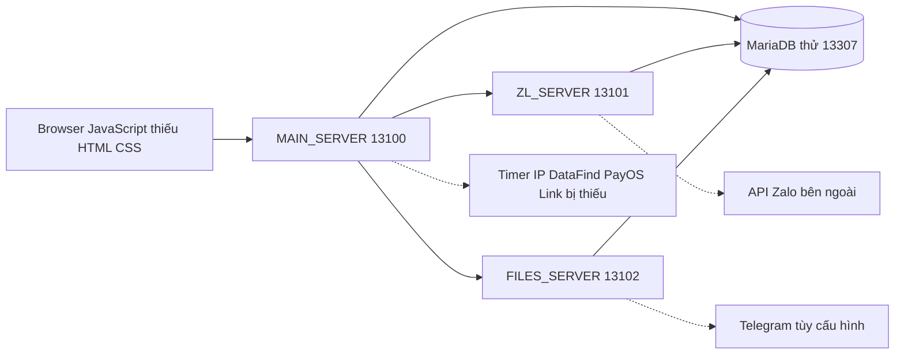

# Phân tích và kết quả dựng mã nguồn PA03

Ngày kiểm tra: 02/11/2026. Nguồn đầu vào: MANGUON.rar. Phạm vi: toàn bộ 73 tệp JavaScript được đính kèm dưới dạng Word; người dùng xác nhận chỉ có gói này.

Đã dựng và chạy được ba backend gốc trên máy, cùng database thử riêng. Đã kiểm chứng 29 tình huống backend cục bộ. Theo yêu cầu tiếp theo, đã bổ sung giao diện mới ở cổng 13103: 25 trang, gồm 31 nhóm chức năng từ mã gốc và luồng xin chia sẻ số điện thoại tự nguyện, có chế độ mẫu và kết nối backend; xem [hướng dẫn giao diện](UI.vi.md) và [hướng dẫn chia sẻ số](PHONE-SHARE.vi.md). HTML/CSS và database gốc vẫn không có trong gói; nhiều dịch vụ được tham chiếu còn thiếu. Các chức năng gửi Zalo, thanh toán, tra cứu bên ngoài chưa được kiểm chứng với hệ thống thật.

## 1. Những gì đã khôi phục và bổ sung

| Thành phần | Kết quả |
|---|---|
| MAIN_SERVER | 30 tệp; xác thực, quản trị, gateway/proxy |
| ZL_SERVER | 34 tệp; công cụ Zalo và các module dự phòng |
| FILES_SERVER | 1 tệp; upload, phục vụ tệp, ghi nhận lượt truy cập ảnh |
| FRONTEND | 8 tệp browser JavaScript; không có tài liệu HTML/CSS đi kèm |
| Mã bị làm rối | Giải mã tĩnh 14 controller, thay 7.115 lời gọi tra bảng chuỗi trong bản sao phân tích |
| Cấu hình dựng | package.json/lock, .env.example, Compose database, START/STOP, script kiểm tra |
| Database thử | Schema suy ra từ SQL trong nguồn; admin giả, không có tài khoản Zalo hoặc tiền thật |

Tệp Word và gói nén được giữ lại. Khi khôi phục chỉ loại dòng đầu `File: ...` vốn là nhãn tài liệu, không phải JavaScript. Không sửa logic nghiệp vụ trong 73 tệp nguồn. Hash tệp nằm ở `recovered/source-manifest.json`. Bản giải mã tại `analysis/readable/` chỉ phục vụ phân tích; runtime vẫn chạy nguồn khôi phục.

## 2. Cách chạy và địa chỉ hiện tại

| Dịch vụ | Địa chỉ | Kiểm tra |
|---|---|---|
| Giao diện mới | http://127.0.0.1:13103 | Xem mẫu hoặc đăng nhập backend |
| MAIN_SERVER | http://127.0.0.1:13100 | GET /health trả JSON |
| ZL_SERVER | http://127.0.0.1:13101 | GET /health cần x-internal-auth |
| FILES_SERVER | http://127.0.0.1:13102 | GET /local-test.png trả ảnh thử |
| MariaDB | 127.0.0.1:13307 | Database pa03_local, container pa03-local-database-1 |

Mở `START.cmd` để chạy lại; `STOP.cmd` để tắt, giữ database. Script bật đã kiểm tra cả trường hợp các tiến trình đang chạy. Không dùng cổng 3100/3307 vì máy có ứng dụng khác chiếm các cổng đó.

Tài khoản `local_admin` và mật khẩu ngẫu nhiên nằm trong `.runtime/LOCAL-ACCESS.txt`. Có thể đăng nhập qua `POST /api/auth/login` với JSON `userName` và `password`, rồi gửi `Authorization: Bearer <token>` khi gọi API. Lấy CSRF tại `GET /api/csrf-token` và gửi `x-csrf-token` cho thao tác ghi ở các route được bảo vệ. Endpoint auth đổi mật khẩu hiện không áp dụng CSRF trong nguồn.

`/health` là API, không phải màn hình ứng dụng. Truy cập `/` ở backend 13100 nhận 404 là đúng với nguồn hiện có. Gói không có các trang HTML gốc. Giao diện được bổ sung nằm trong `web/`, phục vụ qua máy chủ riêng tại 13103.

## 3. Kiến trúc và quyền truy cập

MAIN xác thực JWT và đọc lại trạng thái/quyền user từ database mỗi request. Vai trò dùng trong điều kiện kiểm tra: 1 = Admin, 2 = người dùng đăng ký, 3 = VIP. Có chỗ tạo admin-user mặc định role 0, nhưng không có vai trò đặc biệt tương ứng; không nên suy ra role 0 là Admin.

Người dùng thường được dùng hồ sơ, tài khoản Zalo cá nhân, API gửi ảnh cũ, lịch sử, mua license và nạp tiền. V2, danh thiếp và check-status yêu cầu VIP/Admin tại gateway. OA, Link, Leak và quản trị yêu cầu Admin. Hai ngoại lệ đáng chú ý là nhóm nhật ký `/api/logs/admin/*` chưa kiểm tra Admin và đường `/api/zalo-timer/send` có thể đi qua cổng kiểm tra VIP; xem phần lỗi.

ZL là worker nội bộ: kiểm tra loopback cùng khóa nội bộ, rồi tin `userID` MAIN chuyển đến. FILES không có lớp xác thực trong mã. Cấu hình dựng này chỉ bind loopback và có khóa ngẫu nhiên không rỗng.

## 4. Phân tích các nhóm chức năng

### 4.1 Tài khoản và bảo vệ đăng nhập

Có đăng ký bằng username/email/password kèm CAPTCHA; tài khoản mới role 2, số dư 0. Đăng nhập so bcrypt, phát JWT; xem hồ sơ và đổi mật khẩu bằng mật khẩu hiện tại. Admin có endpoint đăng nhập riêng, token mặc định 7 ngày; đăng nhập thường theo JWT_EXPIRE, mặc định 24 giờ. Giao diện đăng xuất chỉ xóa trạng thái localStorage. Không thấy endpoint quên/khôi phục mật khẩu, xác nhận email, refresh token hoặc thu hồi token.

CAPTCHA gồm 6 ký tự phân biệt hoa/thường, lưu hash SHA256, thời hạn 5 phút. Sau 2 lần sai trong cửa sổ 15 phút sẽ yêu cầu CAPTCHA; khoảng 10 lần thất bại trong 30 phút sẽ chặn IP 15 phút. Có API kiểm tra có cần CAPTCHA, quản trị chặn/gỡ IP và rate limit tạo CAPTCHA. Việc có các cơ chế này trong mã không đồng nghĩa chúng chống bot hiệu quả: đáp án vẫn nằm trong SVG và log.

Đã kiểm chứng đăng ký bằng fixture CAPTCHA cục bộ, đăng nhập, profile, phát CSRF và từ chối người thường ở các API quản trị/VIP được bảo vệ.

### 4.2 Quản lý tài khoản Zalo

Có danh sách/chi tiết/thêm/sửa/xóa, liên kết tài khoản với user, kiểm tra một hoặc tất cả trạng thái. Cách nhập tự động dùng IMEI cùng cookie `zpw_sek` để lấy UID, khóa phiên và profile; cách nhập thủ công nhận thêm UID, displayName, phoneNumber, Avatar, ENCRYPTION_KEY. Có tài khoản hệ thống do Admin chọn trong `tool_setup`; một số công cụ cho chọn tài khoản hệ thống hoặc tài khoản cá nhân.

Thông tin trả cho client được lọc bớt khóa/cookie nhưng log hiện chưa che đúng các trường này. Kiểm tra session và nhập tài khoản thực phụ thuộc các API Zalo web. Đã kiểm chứng danh sách trống qua MAIN → ZL → database; chưa kiểm tra session thật.

### 4.3 Gửi ảnh theo số điện thoại

Luồng V2 có chọn tài khoản, tìm người nhận, xem profile/phí/số dư, xác nhận gửi và hiển thị kết quả. Có ảnh mặc định hoặc PNG tùy chọn, chọn IPv4/IPv6/cả hai và tùy chọn xóa tin ở phía người gửi. Mã xóa dùng `onlyMe=1`; đây không phải bằng chứng thu hồi tin khỏi phía người nhận.

Backend thực hiện giữ khóa dòng số dư bằng transaction cho luồng trả phí. Ghi `auto_request`, liên kết lịch sử với user, tạo URL ảnh có mã yêu cầu và trừ phí theo kết quả. Việc ghép phụ phí có lỗi khi DECIMAL được mysql2 trả dưới dạng chuỗi. Gửi mạng bên ngoài và commit database cũng không tạo thành một giao dịch nguyên tử.

Còn API gửi ảnh cũ `/api/send-image`: dùng tài khoản liên kết đầu tiên, nhận URL ảnh và không có cơ chế phí như V2. API này vẫn được mount cho mọi user đã đăng nhập. Thống kê/lịch sử có sẵn nhưng từ vựng trạng thái giữa luồng cũ và query thống kê không đồng nhất. Đã kiểm chứng đọc lịch sử/thống kê trống; chưa gửi tin thật.

### 4.4 Gửi theo danh thiếp và hẹn giờ

Luồng danh thiếp nhập PARAMS/FID đã mã hóa, chọn tài khoản cá nhân, giải mã để tìm người nhận, xem phí rồi gửi ảnh. Ảnh tùy chọn, loại IP và xóa phía gửi tương tự V2. Giao diện có hẹn giờ và lịch sử lịch chạy, nhưng code worker thực thi lịch không nằm trong gói. Không thấy chức năng sửa/hủy lịch tại frontend được cung cấp.

Chỉ có proxy sang `ZL_TIMER_SERVER`; chưa thể xác nhận lịch được lưu, chạy hay trừ tiền ra sao. Không tạo worker thay thế hoặc dữ liệu trả về giả.

### 4.5 Kiểm tra trạng thái Zalo

Có nhập số điện thoại hoặc PARAMS danh thiếp, pre-check xem profile/phí/số dư rồi xác nhận để lấy `lastActionTime`/last-online. Phí khác nhau theo tài khoản cá nhân/hệ thống hoặc loại danh thiếp. Pre-check đã trả một phần dữ liệu trước khi thu phí; confirm không gắn chặt với kết quả pre-check bằng token giao dịch.

Gateway yêu cầu VIP/Admin dù một số handler frontend chỉ dựa vào trạng thái đăng nhập. Chức năng cần tài khoản Zalo hợp lệ và API bên ngoài; chưa kiểm chứng kết quả trạng thái thật.

### 4.6 Zalo OA và template

Admin có xem/làm mới token OA; danh sách/thêm/sửa/xóa template; lấy template mới từ provider; gửi template theo điện thoại hoặc UID; preview tham số; xem kết quả và cập nhật trạng thái tin. Giao diện tạo form động từ danh sách params và lọc template IPv4/IPv6 qua nội dung detail.

Token/template/kết quả là dữ liệu toàn cục trong worker, không chia theo user. MAIN hiện chặn OA cho người thường. Đã kiểm chứng đọc template/kết quả trống và từ chối người thường; chưa refresh token, đồng bộ template hoặc gửi OA thật.

### 4.7 Ảnh, tệp và dữ liệu lượt truy cập

FILES nhận PNG custom tối đa 3 MiB, thumbnail tối đa 10 MiB, phục vụ tệp không cache và nhận thông tin qua `/remote-server`. Khi tải ảnh có `req` dạng số sẽ nối dữ liệu vào `auto_request.Detail`; mã bắt đầu `BC` vào `oa_result.detail`; query `id` phục vụ kết quả thumbnail của Link. Có log tệp và gửi Telegram nếu cấu hình bot/chat.

Dữ liệu thu gồm IP kết nối/header, cổng nguồn, User-Agent, referer và thời gian. Một lượt tải có thể đến từ máy chủ preview/proxy của Zalo, nên không chứng minh người nhận đã mở ảnh và không cho vị trí vật lý chính xác. Chọn v4/v6 là chọn URL/đường kết nối theo cấu hình; không bảo đảm thiết bị người nhận cung cấp được cả hai loại IP.

Đã kiểm chứng phục vụ ảnh 1 pixel tự tạo, không có mã theo dõi. Bot Telegram để trống. Không thử ghi nhận thiết bị/tài khoản bên ngoài. Cần lưu ý các lỗi đọc/ghi vượt thư mục và nội suy HTML được ghi trong danh mục lỗi.

### 4.8 Sản phẩm và license

Cửa hàng cho xem sản phẩm, chọn gói 1/5/10 lượt, xác nhận mua bằng số dư, xem/copy key và xem các license đã mua. Admin quản lý sản phẩm, ba mức giá, ảnh/mô tả, bật/tắt; quản lý license, lọc/phân trang, xem chi tiết, tăng lượt, vô hiệu hóa, xóa và thống kê.

`countDown` là số lượt sử dụng, không phải thời hạn ngày. Chưa thấy endpoint kích hoạt/tiêu thụ license phục vụ phần mềm bên ngoài trong các route được mount. Chuỗi `licenseType` có thể bị tính phí nhưng tạo 0 lượt; query thống kê cũng tham chiếu các trường không nhất quán. Đã kiểm chứng đọc catalog/license trống; chưa thực hiện mua hoặc ghi giao dịch.

### 4.9 Nạp tiền PayOS

Frontend có tạo yêu cầu nạp từ 10.000 VND, mở URL checkout, xem lịch sử và hủy yêu cầu chờ. MAIN chỉ chuyển tiếp đến `CASH_PAYOS`. Không có phần tích hợp PayOS, webhook xác minh thanh toán, cộng tiền hay chống webhook lặp trong gói này.

Gọi đọc lịch sử hiện trả 500 vì upstream không tồn tại. Không thể kết luận nạp tiền hoạt động từ các script frontend/proxy. Không tạo giao dịch hoặc dùng khóa thanh toán thật.

### 4.10 Tra cứu IP

Giao diện nhập IPv4/IPv6 và hiển thị quốc gia, vùng/thành phố, ISP/tọa độ và bản đồ tùy dữ liệu trả về. MAIN chuyển `/api/check-ip/location` sang `MINI_SERVICE_SERVER` đang thiếu. ZL có controller tra cứu/scrape `kiemtraip.vn` và route riêng, nhưng MAIN không trỏ vào implementation đó. Vì vậy có mã tính năng tương tự trong ZL vẫn không làm đường API của frontend hoạt động.

Không tự đổi luồng proxy hoặc gọi website bên ngoài để che phần dịch vụ bị thiếu. Cần đối chiếu hợp đồng dữ liệu nếu muốn sử dụng controller ZL thay thế.

### 4.11 Tra cứu dữ liệu rò rỉ

Hub Admin có điện thoại, email và Facebook. Luồng gồm nhập → pre-check phí/số dư → confirm → kết quả theo nguồn; có lịch sử cá nhân và lịch sử toàn hệ thống kèm phí/kết quả. Admin chỉnh phí tra cứu. Frontend thể hiện chính sách chỉ tính phí khi có dữ liệu, nhưng code quyết định nằm ở `DATA_FIND_SERVER` bị thiếu nên chưa xác minh được chính sách đó.

Nhánh Facebook còn gọi `/api/facebook/find-uid`, không được mount trong MAIN hiện tại. ZL có router Facebook dự phòng cho liên kết tài khoản/scrape bài viết nhưng không được mount, và `FB_SERVER` cũng không có trong gói.

### 4.12 Quản lý liên kết

Hub Admin có CRUD trang mẫu, lấy metadata URL, upload thumbnail, CRUD domain, tạo/sửa link từ mẫu và domain, copy URL đầy đủ/rút gọn, danh sách kết quả link/thumbnail và lọc kết quả. UI có bốn chế độ vị trí, kể cả chế độ yêu cầu cấp quyền trước khi tải nội dung. Không có implementation landing page, xin quyền trình duyệt, lưu tọa độ hay rút gọn URL vì `LINK_SERVER` thiếu.

FILES chỉ cung cấp một phần nhận hit thumbnail; phần đó không đủ để chạy hệ thống Link. Không thấy endpoint xóa link riêng trong các route được cung cấp, dù có xóa template/domain.

### 4.13 Quản trị và cấu hình phí

Admin quản lý user/role/trạng thái/số dư, xem thống kê, chọn tài khoản Zalo hệ thống, cấu hình phí gửi/check-status/danh thiếp/leak, xem yêu cầu gửi và chặn IP. Có kiểm tra ngăn tự xóa và ý định ngăn tự khóa/hạ quyền, nhưng logic cập nhật còn lỗi kiểu dữ liệu/bỏ trường. Giá 0 ở một số form hoặc khởi tạo bị thay bởi mặc định vì dùng `||`.

Đã kiểm chứng danh sách user, sản phẩm, license, cấu hình phí và quyền từ chối user thường. Không nạp tiền, sửa quyền của user thật hoặc xóa dữ liệu thật.

### 4.14 Nhật ký và vận hành

Có ghi người dùng/IP, request/body/query, loại sự kiện, mã phản hồi và thời gian. API có nhật ký cá nhân/toàn hệ thống/theo user, tìm kiếm, thống kê, cảnh báo và dọn log. Nhiều hàm đọc log sai kiểu trả về của `db.query`, làm lỗi hoặc trả một dòng thay cho danh sách. Các đường admin log thiếu kiểm tra Admin; đã tái hiện user role 2 gọi tìm kiếm admin được HTTP 200.

MAIN có Helmet, CORS allowlist, Morgan và rate limiter, nhưng các giới hạn không phủ hết route như comment mô tả. CSRF lưu trong RAM theo user/IP, dễ xung đột nhiều tab hoặc nhiều instance. Health của MAIN chỉ xác nhận process đáp ứng, không tự kiểm database/upstream; bộ smoke bổ sung đã kiểm đường đi database thực tế.

## 5. Các thành phần thiếu

| Thành phần | Ảnh hưởng |
|---|---|
| HTML/CSS, trang đăng nhập/user/admin, ảnh/icon/font gốc | Không khôi phục được thiết kế gốc; đã dựng giao diện mới trong web/ để xem các luồng |
| Flatpickr, SweetAlert2 và tài nguyên UI được tham chiếu | Thiếu dependency browser và thứ tự load script |
| SQL dump/migrations gốc | Chưa biết schema, index, khóa ngoại/cascade, view và dữ liệu chuẩn |
| .env gốc | Chưa có domain ảnh thật, Zalo/OA credentials, proxy, Telegram và cấu hình triển khai |
| ZL_TIMER_SERVER | Không có worker thực thi hẹn giờ |
| MINI_SERVICE_SERVER | API tra cứu IP mà MAIN đang dùng không chạy |
| DATA_FIND_SERVER | Không có engine/dữ liệu/logic thu phí tra cứu |
| CASH_PAYOS | Không có tạo thanh toán/webhook/cộng tiền |
| LINK_SERVER | Không có backend Link và trang đích |
| FB_SERVER và mount API Facebook | Tính năng Facebook chỉ hiện diện một phần, chưa nối vào hệ thống |
| Hạ tầng triển khai gốc | Không có cấu hình reverse proxy, TLS, public image host hoặc giám sát |

Các API Zalo web trong nguồn có thể phụ thuộc phiên và thay đổi phía provider. Việc giải mã/đọc được code không xác nhận chúng còn tương thích hiện tại. Đường OA công khai cũng cần app/token/quyền thực tế.

## 6. Các vấn đề cần ưu tiên

1. **Phân quyền nhật ký:** người thường truy cập được `/api/logs/admin/*`; dọn log còn có thể DELETE xong mới trả lỗi do destructure sai. Cần chặn quyền trước thao tác dữ liệu.
2. **FILES đọc/ghi vượt thư mục:** thiếu xác thực và kiểm tra containment cho đường dẫn/tên tệp nhận từ request. Chưa kiểm thử khai thác đọc tệp hoặc ghi ngoài thư mục; kết luận dựa trên mã.
3. **Thông tin bí mật trong log:** mật khẩu đổi, cookie/khóa Zalo và đáp án CAPTCHA không được che đúng. Cần loại khỏi log trước khi dùng dữ liệu thật.
4. **CAPTCHA và IP:** đáp án SVG đọc được bằng chương trình; tin header IP trực tiếp; xác minh CAPTCHA chưa ràng buộc IP và dùng một lần chưa nguyên tử.
5. **Phí/license:** sai kiểu `licenseType`, cộng phụ phí chuỗi DECIMAL, thống kê sai trường và luồng gửi cũ không thu phí như V2.
6. **CSRF và gateway:** token sai độ dài trả 500; lưu token RAM một giá trị mỗi user/IP; đường timer tổng quát có thể bỏ kiểm VIP.
7. **Nội dung HTML:** nhiều bảng/modal gán dữ liệu vào innerHTML chưa escape; FILES cũng lưu chuỗi HTML từ header. Nguy cơ XSS phụ thuộc đường hiển thị và CSP thực tế.
8. **Tính nhất quán giao dịch:** gửi tin ngoài mạng trước commit, không có idempotency/outbox; hit ảnh có thể đến trước bản ghi tracking được commit.

Tổng hợp theo nhóm có 29 ghi nhận MAIN, 20 frontend và 20 ZL/FILES; một số cùng nguyên nhân nên không cộng thành 69 lỗi độc lập. Danh mục có vị trí nguồn và phân biệt mã đang mount với mã dự phòng tại [ISSUES.vi.md](ISSUES.vi.md). Đây là các vấn đề đã phân tích trong nguồn; bản dựng không tự sửa toàn bộ nghiệp vụ.

## 7. Kết quả kiểm chứng và giới hạn

`node tools/audit-source.cjs`: 73/73 tệp qua kiểm tra cú pháp. Có 222 khai báo route/mount trong toàn gói, gồm cả module không được sử dụng; không coi chúng là 222 API hoạt động. MAIN mount 110 tổ hợp method/path, trong đó nhiều đường chỉ là proxy sang dịch vụ thiếu. Phụ lục phân biệt quyền và nơi thực thi.

`node tools/smoke-local.cjs`: 29 kiểm tra đạt, không có kiểm tra chính thất bại. Các kiểm tra đọc catalog/history dùng dữ liệu trống, không xác minh kết quả gửi thật hoặc phép tính phí có dữ liệu. Đăng ký dùng CAPTCHA fixture được sửa hash trong database thử; không chứng minh khả năng chống bot của CAPTCHA. User tạm và challenge fixture được xóa sau kiểm tra.

Ba quan sát riêng được ghi nhận: CSRF ngắn → 500; user thường tìm kiếm admin log → 200; PayOS history → 500 do thiếu dịch vụ. Hai lỗi đầu chưa được sửa và không được tính là chức năng nghiệp vụ hoạt động đúng.

Không gọi gửi Zalo, OA, tra cứu dữ liệu, PayOS thật hoặc Telegram. Giao diện mới đã được kiểm tra riêng bằng trình duyệt; xem UI.vi.md và analysis/ui-browser-verification.json. Không suy đoán kết quả định vị hay dữ liệu cá nhân từ mã.

Bằng chứng máy đọc được: `analysis/runtime-verification.json`, `analysis/source-audit.json`, `analysis/main-findings.json`, `analysis/frontend-findings.json`, `analysis/zalo-findings.json`. Thư viện đã được khóa; lần `npm audit` trong phiên dựng không báo lỗ hổng đã biết, điều đó không loại trừ các lỗi trong code ứng dụng.

## 8. Phụ lục và hướng hoàn thiện

- [31 nhóm chức năng frontend, đầu vào và endpoint](FEATURE-MATRIX.vi.md)
- [110 endpoint gateway, quyền và middleware](API-REFERENCE.md)
- [Danh mục vấn đề có vị trí mã nguồn](ISSUES.vi.md)

Đã bổ sung lớp giao diện và đăng nhập mới. Để vận hành đầy đủ bằng dữ liệu thật, còn cần xác định schema chuẩn, bổ sung từng dịch vụ thiếu theo hợp đồng API, sửa các vấn đề ưu tiên và kiểm thử tích hợp bằng tài khoản/provider hợp lệ. Dữ liệu mẫu ở frontend không thay thế các implementation còn thiếu.

Quyết định dependency: giữ Express 4 để tương thích các route wildcard cũ; Express 5 thay đổi cú pháp đường dẫn theo [tài liệu migration chính thức](https://expressjs.com/en/guide/migrating-5/). MySQL2 được dùng theo mô hình promise/prepared statement của [tài liệu chính thức](https://sidorares.github.io/node-mysql2/docs); schema local vẫn là suy luận từ nguồn.
