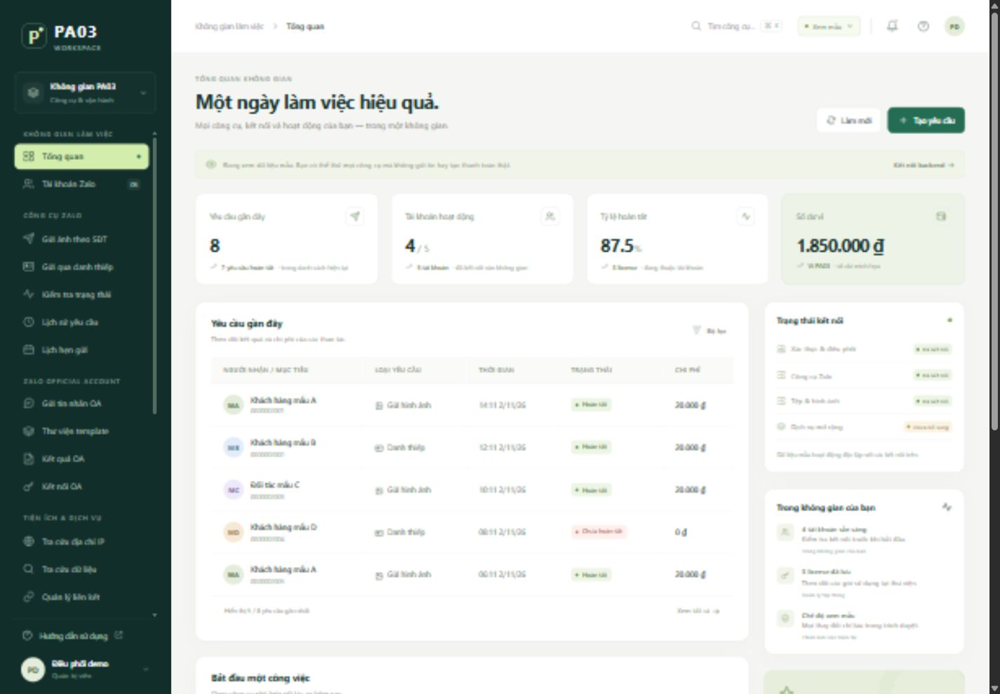
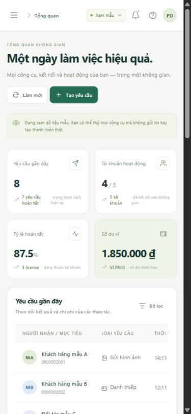

# Giao diện PA03

Mở http://127.0.0.1:13103/#overview để xem. Giao diện tiếng Việt gồm 25 trang: các tab cho đủ 31 nhóm chức năng đã phân tích từ mã nguồn và chức năng xin chia sẻ số điện thoại tự nguyện.

## Xem ngay bằng dữ liệu mẫu

Giao diện mặc định ở chế độ **Xem mẫu**, có thông báo trên mọi trang. Không cần đăng nhập để xem toàn bộ màn hình. Bạn có thể đi qua luồng tìm người nhận → xem phí → xác nhận mô phỏng → kết quả; mua license mẫu; tạo/sửa sản phẩm, tài khoản, template hoặc link; xem lịch sử, nhật ký và bảng quản trị.

Dữ liệu mẫu lưu riêng trong trình duyệt. Nó không dùng token đăng nhập thật, không gửi tin Zalo, không thu tiền và không thực hiện tra cứu bên ngoài. Hộp xác nhận và kết quả cũng ghi rõ thao tác mẫu. Nạp tiền mẫu chỉ tạo yêu cầu chờ, không tự cộng tiền vào ví.

Chọn biểu tượng **Trợ giúp** → **Khôi phục dữ liệu mẫu** để đặt lại các thay đổi. Dữ liệu backend không bị ảnh hưởng. Dùng Ctrl/⌘ K để tìm nhanh công cụ.

## Các trang đã bổ sung

| Trang | Chức năng để xem và thao tác |
|---|---|
| Tổng quan | Thẻ số liệu, ví, yêu cầu gần đây, truy cập nhanh, biểu đồ, trạng thái backend |
| Tài khoản Zalo | Danh sách, thêm/sửa/xóa, nhập tự động, kiểm tra phiên |
| Gửi ảnh theo SĐT | Chọn tài khoản, tìm người nhận, báo phí, PNG tùy chọn, loại IP, xóa phía gửi, xác nhận/kết quả |
| Gửi qua danh thiếp | PARAMS/FID, tài khoản cá nhân, giải mã, báo phí và gửi |
| Xin chia sẻ số điện thoại | Tạo liên kết có hạn, người nhận tự nhập số/đồng ý hoặc từ chối, xem phản hồi, hủy/xóa; [hướng dẫn và giới hạn localhost](PHONE-SHARE.vi.md) |
| Kiểm tra trạng thái | Hai tab điện thoại/danh thiếp, pre-check và kết quả last-online |
| Lịch sử yêu cầu | Lọc, phân trang, kết quả, chi phí và chi tiết |
| Lịch hẹn gửi | Danh sách, thời gian chạy và trạng thái; tạo từ biểu mẫu gửi ảnh |
| Gửi tin OA | Hai tab điện thoại/UID, mẫu chính/phụ, tham số động, preview và kết quả từng mẫu |
| Thư viện template | CRUD, tìm mẫu từ Zalo, chọn ứng viên, nhập nội dung rồi xác nhận lưu |
| Kết quả OA | Danh sách, chi tiết và cập nhật trạng thái tin |
| Kết nối OA | Token, hạn sử dụng và biểu mẫu refresh |
| Tra cứu IP | Kiểm tra đầu vào, dữ liệu mạng/vị trí, liên kết bản đồ |
| Tra cứu dữ liệu | Điện thoại/email/Facebook, pre-check phí, confirm, kết quả và lịch sử |
| Quản lý liên kết | Tab link/trang mẫu/domain/kết quả/thumbnail; metadata, upload, CRUD và copy |
| Cửa hàng license | Thẻ sản phẩm, chọn 1/5/10 lượt, báo phí, xác nhận và key |
| License đã mua | Danh sách, lượt còn lại, trạng thái, chi tiết và sao chép |
| Ví & nạp tiền | Tạo yêu cầu, lịch sử, trạng thái, hủy yêu cầu chờ và URL thanh toán backend |
| Người dùng & quyền | CRUD tài khoản, vai trò/số dư/trạng thái và tab IP bị chặn |
| Cấu hình Zalo | Chọn tài khoản hệ thống, chỉnh phí, xem lịch sử toàn hệ thống |
| Quản lý sản phẩm | CRUD tên/mô tả/ảnh/ba mức giá, bật/tắt |
| Quản lý license | Bộ lọc toàn bộ dữ liệu, phân trang, chi tiết, tăng lượt và thu hồi |
| Quản lý tra cứu | Cấu hình phí và lịch sử toàn hệ thống |
| Nhật ký & hệ thống | Nhật ký cá nhân/toàn hệ thống/bảo mật/trạng thái, bộ lọc và chi tiết |
| Hồ sơ cá nhân | Thông tin user, số dư, vai trò và biểu mẫu đổi mật khẩu |

## Kết nối backend cục bộ

Mở `START.cmd`, chọn **Xem mẫu** ở thanh trên → **Đăng nhập backend**, hoặc dùng liên kết **Kết nối backend** trong thông báo. Tài khoản quản trị thử nằm trong `.runtime/LOCAL-ACCESS.txt`. Giao diện cũng có biểu mẫu đăng ký kèm CAPTCHA từ backend.

Sau đăng nhập, dữ liệu và thao tác đến từ API thực của các backend cục bộ. Danh sách có thể trống vì database thử không được nạp tài khoản Zalo, sản phẩm hoặc giao dịch thật. Giao diện không tự thay bằng dữ liệu mẫu nếu một API lỗi. Chọn lại chế độ mẫu để tiếp tục khám phá các màn hình.

Các dịch vụ Timer, MiniService/IP, DataFind, PayOS và Link chưa có implementation trong gói; lỗi hoặc trạng thái chưa sẵn sàng trong chế độ backend là giới hạn thực tế. Gửi Zalo/OA cần tài khoản, token và dịch vụ bên ngoài hợp lệ. Chế độ mẫu chỉ trình diễn các luồng này.

## Chạy và cấu trúc

- `START.cmd`: bật database, ba backend và UI.
- `STOP.cmd`: tắt các tiến trình của dự án và giữ database.
- `npm.cmd run start:ui`: chỉ bật UI, dùng chế độ mẫu không cần backend.
- `npm.cmd run test:ui`: kiểm tra adapter dữ liệu và máy chủ giao diện.

Giao diện mới nằm trong `web/`; `ui/server.cjs` chỉ phục vụ thư mục web và proxy `/api` sang MAIN trên loopback. Không sửa 73 tệp nghiệp vụ đã khôi phục. Các script frontend gốc vẫn được giữ để đối chiếu; giao diện mới dùng module riêng để tránh phụ thuộc DOM/global của các script đó.

API client giữ bearer và CSRF riêng cho phiên backend; khi backend trả 403 xác định là lỗi CSRF, client lấy token mới và thử lại đúng một lần. Lỗi phân quyền khác không được tự thử lại. Dữ liệu kết quả gửi giữ nguyên chi tiết từng IP, phí và số dư từ backend.

## Đã kiểm chứng

25 kiểm tra tự động ban đầu đạt, bao gồm dữ liệu mẫu không gọi mạng, CRUD lưu bền, không đủ số dư, gói license 1/5/10, lọc license trước phân trang, phụ phí ảnh, compound API responses, CSRF recovery giới hạn một lần, live failure không fallback và proxy không lộ cấu hình riêng.

Kiểm tra giao diện ban đầu: 24/24 trang mở được; 48 lượt kiểm tra bố cục tại 1440px và 390px không tràn ngang toàn trang; không có lỗi JavaScript trong phiên kiểm tra. Bảng rộng cuộn ngang bên trong bảng trên điện thoại. Đã thử các luồng mẫu gửi ảnh, mua license, nhập template OA, tạo sản phẩm và reset; đăng nhập local backend đọc được catalog thật trống. Regression chuyển mẫu → mở đăng nhập → hủy giữ đúng chế độ mẫu dù đã có phiên backend.

Bổ sung ngày 03/11/2026: trang thứ 25 xin chia sẻ số điện thoại và trang riêng cho người nhận. 38 bài kiểm tra UI/API đạt, 11 kiểm tra riêng với backend cục bộ đạt; đã thử đồng ý, từ chối, hủy, sao chép, chuyển liên kết trong cùng tab, chuyển từ danh thiếp và bố cục 390px. Số thử là dữ liệu giả; bản ghi thử backend đã xóa. Xem chi tiết tại [PHONE-SHARE.vi.md](PHONE-SHARE.vi.md).

Không gửi tin, thanh toán hoặc tra cứu thật khi kiểm tra. Các lỗi backend gốc trong `ISSUES.vi.md` vẫn là hạng mục riêng. Bằng chứng trình duyệt: `analysis/ui-browser-verification.json`; kết quả kiểm tra tự động: `npm.cmd run test:ui`.

